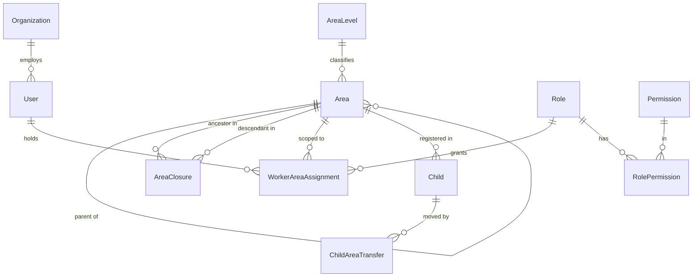
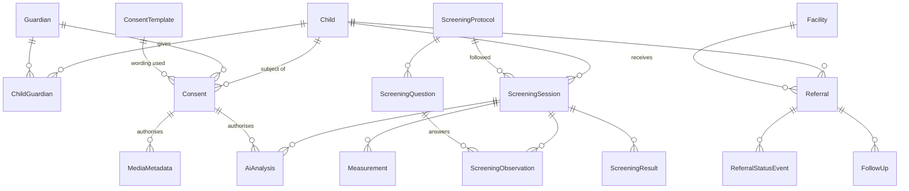

# BalSwasthya AI - Database Design (Proposal v0.1)

> **Status: APPROVED 2026-11-21 (v0.1).** Approved by the project lead with the proposed defaults for
> decisions D3-D6 and D10 (§12). D1, D2 and D7-D9 remain assumptions pending confirmation by the
> RBSK programme, legal and clinical teams.
>
> **Implemented in step 3:** `services/api/prisma/schema.prisma`, migration
> `services/api/prisma/migrations/*_init` (§8 + §9 SQL + append-only audit triggers), runtime account
> `infrastructure/db/setup-app-role.sql`, access control
> `services/api/src/modules/access-control/accessScope.ts`, area tree
> `services/api/src/modules/areas/areaTree.ts`, scenario tests `services/api/tests/db/`.

> ⚠️ **Assumption - to be confirmed with the RBSK programme team.**
> The geographical hierarchy (State → District → Block → Sector → Village / Anganwadi Centre),
> the role names, consent methods, facility types and measurement types used in this document are
> **illustrative**. They are not an officially confirmed Uttar Pradesh programme structure.
> The design does not depend on them: levels, roles and permissions are configuration data.

Related: [architecture.md](architecture.md) (system design), §12 below (open decisions).

---

## Contents

1. [Design principles](#1-design-principles)
2. [Entity overview](#2-entity-overview)
3. [Area hierarchy](#3-area-hierarchy)
4. [Roles, permissions and worker area assignments](#4-roles-permissions-and-worker-area-assignments)
5. [Access-control rules](#5-access-control-rules)
6. [Example scenarios](#6-example-scenarios)
7. [Other domain entities](#7-other-domain-entities)
8. [Prisma schema (proposed)](#8-prisma-schema-proposed)
9. [SQL migration additions](#9-sql-migration-additions)
10. [Indexes and performance](#10-indexes-and-performance)
11. [Privacy, retention and audit](#11-privacy-retention-and-audit)
12. [Open decisions for review](#12-open-decisions-for-review)

---

## 1. Design principles

| Principle | How the design applies it |
|---|---|
| **Where vs what** | *Where* a user may act comes from **area assignments**. *What* they may do comes from the **role** on each assignment. Both are checked on every request, on the server. |
| **Deny by default** | No assignment → no access. No permission on the role → no access. Inactive user → no access. |
| **Configuration, not schema** | Area levels, roles and role permissions are rows, not enums. Renaming or adding a level needs no migration. |
| **History is never overwritten** | Assignments, consents, referral status changes and child transfers are appended or closed, never edited in place. |
| **Minimum personal data** | No Aadhaar. Guardian phone encrypted (proposed). Logs and audit never contain names, phone numbers or health details. |
| **Screening, not diagnosis** | Results store outcome categories, reasons, limitations, rule/model versions and review status - never a diagnosis field. |
| **Clinical content is data with provenance** | Screening protocols carry a version, a source reference and clinical-approval status. No thresholds are defined in this document. |
| **Time** | All timestamps are `timestamptz` (stored in UTC). Calendar dates (date of birth, due dates) are `date`. |
| **Identifiers** | UUID primary keys everywhere (not guessable, safe for offline creation). |

---

## 2. Entity overview

### 2.1 Access-control core



### 2.2 Child, consent, screening and referral



Supporting entities: `RefreshSession` (login sessions), `SyncOperation` (offline idempotency),
`Notification`, `AuditLog`.

---

## 3. Area hierarchy

### 3.1 Tables

**`AreaLevel`** - the configurable list of levels.

| Column | Purpose |
|---|---|
| `code` | Stable machine code, e.g. `DISTRICT`. Unique. |
| `nameEn`, `nameHi` | Display names. **Renaming a level = updating these.** |
| `rank` | Position in the hierarchy; smaller = higher. Unique. Gaps (10, 20, 30...) allow a level to be inserted later (e.g. 35). |
| `allowsChildRegistration` | Whether children can be registered directly at areas of this level (e.g. Village, Anganwadi Centre). |
| `isActive` | Retired levels stay for history but cannot receive new areas. |

**`Area`** - one row per geographical unit; self-referencing `parentId`.

| Column | Purpose |
|---|---|
| `levelId` | FK → `AreaLevel`. |
| `parentId` | FK → `Area` (null only for the root). `ON DELETE RESTRICT`. |
| `code` | Internal code, unique among siblings. |
| `externalCode` | Optional official code (e.g. a government directory code) - **source to be confirmed**; unique per level when present. |
| `nameEn`, `nameHi` | Names. |
| `depth` | Distance from the root (denormalised, maintained with the closure table). |
| `isActive`, `deactivatedAt` | Areas are deactivated, never deleted. |

**`AreaClosure`** - every (ancestor, descendant) pair, including each area paired with itself
at `depth = 0`. This is what makes "is this child inside any of my areas?" a single indexed join.

Illustrative hierarchy used in this document (**assumption**):

| rank | code | nameEn | nameHi | allowsChildRegistration |
|---|---|---|---|---|
| 10 | STATE | State | राज्य | no |
| 20 | DISTRICT | District | ज़िला | no |
| 30 | BLOCK | Block | ब्लॉक | no |
| 40 | SECTOR | Sector | सेक्टर | no |
| 50 | VILLAGE | Village | गाँव | yes |
| 60 | ANGANWADI_CENTRE | Anganwadi Centre | आंगनवाड़ी केंद्र | yes |

### 3.2 Why a closure table

| Option | Descendant check | Fits Prisma | Moving a subtree | Verdict |
|---|---|---|---|---|
| Recursive CTE on `parentId` only | Recursive query per request | Raw SQL only | Trivial | Slow for state-level scopes; every check is raw SQL |
| Materialised path (`/a/b/c`) | `LIKE 'prefix%'` | `startsWith` works, index needs raw SQL | Rewrite paths | Workable, string-based |
| **Closure table** | **One indexed join / `EXISTS`** | **Normal relation filters** | Delete + insert link rows | **Chosen** |

Size: rows ≈ number of areas × average depth. For the order of 100,000 lowest-level areas × 6
levels that is roughly 600,000 narrow rows - small for PostgreSQL.

### 3.3 Hierarchy rules

1. **Exactly one root** (the State, in the illustrative hierarchy).
2. **Parent must be higher**: `parent.level.rank < child.level.rank`. Levels may be skipped
   (e.g. a village directly under a block) - real hierarchies are irregular. Enforced by a database
   trigger (§9) as well as the service layer.
3. `Area.code` is unique among siblings; `externalCode` is unique within a level when present.
4. Areas and levels are **never hard-deleted** (`RESTRICT` foreign keys). Deactivated areas keep
   their records and history; new registrations and new assignments to them are refused.
5. Every structural change (create, rename, move, deactivate) is written to `AuditLog` in the
   same transaction.

### 3.4 Configuration operations (no schema change needed)

| Change | How |
|---|---|
| Rename a level (e.g. "Sector" → "Cluster") | Update `AreaLevel.nameEn/nameHi`. Codes stay stable. |
| Add a level between two others | Insert `AreaLevel` with an intermediate `rank` (e.g. 35), create the new areas, re-parent the affected areas (subtree moves below). |
| Remove a level | Re-parent its child areas to its parent, deactivate its areas, set `AreaLevel.isActive = false`. The rank rule still holds because ranks only increase downward. |
| Move a subtree (e.g. sector transferred to another block) | One transaction: re-parent, then rebuild closure links for the subtree (SQL in §9.5). Access changes automatically: no assignment needs editing. |
| Split a district | Create the new district, move the relevant blocks under it. History is preserved because records keep the area IDs they were created in. |

---

## 4. Roles, permissions and worker area assignments

### 4.1 Roles and permissions

`Role` and `Permission` are tables joined by `RolePermission`. Permission **codes** are defined in
the API source code (each one is checked somewhere) and seeded into the table. Which permissions a
role has is configuration.

Illustrative permissions:

| Permission | Allows |
|---|---|
| `child.read` / `child.create` / `child.update` | Individual child records and guardians |
| `consent.record` | Record or withdraw guardian consent |
| `screening.conduct` | Create and complete screening sessions, measurements |
| `screening.review` | Clinical review of screening results |
| `referral.create` / `referral.update` | Referrals and follow-ups |
| `report.aggregate` | Counts and summaries only - **no individual records** |
| `assignment.manage` | Create/end/suspend assignments inside the holder's own scope |
| `area.manage` | Change the area hierarchy |
| `facility.manage` | Facility directory |
| `audit.read` | Read audit records |

Illustrative roles (**assumption - names and permission sets to be confirmed**):

| Role | Typical permissions |
|---|---|
| `ASHA` | child.read/create/update, consent.record, screening.conduct, referral.create |
| `ANGANWADI_WORKER` | child.read/create/update, consent.record, screening.conduct, referral.create |
| `MHT_MEDICAL_OFFICER` (RBSK mobile health team) | above + screening.review, referral.update |
| `SUPERVISOR` | child.read, referral.update, report.aggregate, assignment.manage |
| `DISTRICT_ADMIN` | report.aggregate, assignment.manage, facility.manage |
| `STATE_ADMIN` | report.aggregate, assignment.manage, area.manage, facility.manage, audit.read |

District and state administrators **do not** read individual child records by default
(data minimisation). If a programme role needs that, it is granted explicitly.

There are no special "global" users. System-wide powers are an assignment at the **root area** with
`AREA_AND_DESCENDANTS` scope, so even administrators go through the same rules and audit trail.

### 4.2 `WorkerAreaAssignment`

One row = "this user holds this role in this area, with this scope, for this period".

| Column | Purpose |
|---|---|
| `userId`, `areaId`, `roleId` | Who, where, what. FKs with `RESTRICT`. |
| `scope` | `AREA_ONLY` - this area only. `AREA_AND_DESCENDANTS` - this area and everything below it. |
| `status` | `ACTIVE`, `SUSPENDED` (temporary, e.g. leave), `REVOKED` (permanent). Administrative state. |
| `effectiveFrom` | When access starts (`timestamptz`). Can be in the future. |
| `effectiveTo` | When access ends, **exclusive**; `null` = open-ended. |
| `reason` | Free text reference, e.g. an order number. Must not contain personal data of children. |
| `createdById`, `createdAt` | Who made the assignment. |
| `statusChangedById`, `statusChangedAt`, `statusChangeReason` | Last suspension/revocation. Full history is in `AuditLog`. |

An assignment is **effective** at time *t* when all of these hold:

```
status = 'ACTIVE'  AND  effectiveFrom <= t  AND  (effectiveTo IS NULL OR effectiveTo > t)
AND the user's status = 'ACTIVE'  AND  the role's isActive = true
```

(The role condition was made explicit during implementation in step 3; deactivating a role
immediately removes the access it granted.)

`status` and the date window are deliberately separate: dates describe the planned period, status
records administrative action (a suspension does not rewrite the planned end date).

### 4.3 History rules

- `userId`, `areaId`, `roleId`, `scope` and `effectiveFrom` are **immutable** after creation. A
  change of area, role or scope = end the old assignment (`effectiveTo = now`) and create a new one.
  The full history of who could access what, and when, is therefore preserved.
- Only `effectiveTo` (shortening or ending), `status` and the `statusChanged*` fields may be updated.
- The database prevents two non-revoked assignments for the same user, area and role from
  **overlapping in time** (exclusion constraint, §9.2) and rejects `effectiveTo <= effectiveFrom`.
- Every create / end / suspend / reactivate / revoke writes an `AuditLog` row in the same
  transaction, with before/after values (§11.3).

### 4.4 Who can manage assignments

To create or change an assignment, the acting user must:

1. hold `assignment.manage` through an effective assignment whose scope **covers the target area**;
2. only grant a role whose permissions are a **subset** of the permissions they hold over that area
   (no privilege escalation);
   **Amended by D11 (2026-11-21):** the subset rule applies to *management* permissions
   (`report.aggregate`, `assignment.manage`, `user.manage`, `area.manage`, `facility.manage`,
   `audit.read`). *Fieldwork* permissions (`child.*`, `consent.record`, `screening.*`, `referral.*`) may
   be granted inside the actor's area without being held, so administrators who do not read child
   records (D3) can still provision field workers. See [authorization.md](authorization.md) §7;
3. not modify their **own** assignments;
4. give a reason.

Violations are refused and audited with outcome `DENIED`.

---

## 5. Access-control rules

### 5.1 Rules

| # | Rule |
|---|---|
| R1 | A user can act on a child only if they hold an **effective assignment** that **covers the child's current area** and whose **role has the required permission**. |
| R2 | An assignment covers an area if `scope = AREA_ONLY` and it is the same area, or `scope = AREA_AND_DESCENDANTS` and the area is that area or below it. |
| R3 | A parent-area assignment grants **nothing below it** unless its scope is `AREA_AND_DESCENDANTS`. Inheritance is never implicit. |
| R4 | A user with several assignments has the **union** of their coverage, evaluated per permission (a permission from one assignment does not extend another assignment's area). |
| R5 | Users whose account is not `ACTIVE` have no access, whatever their assignments. |
| R6 | Guardians, consents, screening sessions, measurements, results, referrals, follow-ups and media are accessible **only through an accessible child**. |
| R7 | Aggregate reports (`report.aggregate`) are computed only over areas covered by the user's assignments that grant that permission, and never return individual-level rows. |
| R8 | Deny by default. Unknown permission, missing assignment or any error = deny. |
| R9 | Enforcement is **server-side only**. The app hides buttons for usability; the API never trusts it. |
| R10 | Assignments are evaluated **per request from the database**, not stored in the JWT, so ending or suspending an assignment takes effect on the next request. |
| R11 | A record that exists but is outside the user's scope returns **404 Not Found** (same as non-existent) to avoid revealing that it exists, and is audited as `DENIED`. |

### 5.2 Reference query

The coverage check for "can user `:u` use permission `:p` on child `:c`" (and the list filter for
"all children user `:u` may read") is one `EXISTS` over the closure table:

```sql
SELECT c.id
FROM "Child" c
WHERE c."deletedAt" IS NULL
  AND EXISTS (SELECT 1 FROM "User" u WHERE u.id = :u AND u.status = 'ACTIVE')
  AND EXISTS (
    SELECT 1
    FROM "WorkerAreaAssignment" a
    JOIN "Role" r            ON r.id = a."roleId" AND r."isActive"
    JOIN "RolePermission" rp ON rp."roleId" = a."roleId"
    JOIN "Permission" p      ON p.id = rp."permissionId" AND p.code = :p
    JOIN "AreaClosure" ac    ON ac."ancestorId" = a."areaId" AND ac."descendantId" = c."areaId"
    WHERE a."userId" = :u
      AND a.status = 'ACTIVE'
      AND a."effectiveFrom" <= now()
      AND (a."effectiveTo" IS NULL OR a."effectiveTo" > now())
      AND (a.scope = 'AREA_AND_DESCENDANTS' OR ac.depth = 0)   -- AREA_ONLY = self link only
  );
```

### 5.3 Enforcement in the API

- One module, `access-control` (`services/api/src/modules/access-control/accessScope.ts`), owns
  this logic. It exposes:
  - `childScopeWhere(userId, permission, at?)` → a Prisma `where` fragment (relation filter
    equivalent to the query above) that **every** child-related query must include;
  - `findChildOrDeny(db, ctx, childId, permission)` for single-record operations (404 + audit);
  - `countChildrenInScope(db, ctx)` for aggregate reports.
- Repositories for child-linked entities take the access filter as a **required parameter**, so a
  query without it does not compile.
- Every protected route declares its permission; a route without one is rejected at startup.
- Tests: each child-linked endpoint gets "outside-scope user gets 404" and "AREA_ONLY does not reach
  descendants" tests (the scenarios in §6 become test fixtures).

---

## 6. Example scenarios

Synthetic illustrative tree (**assumption**, names are placeholders):

```
State UP
├── District D1
│   ├── Block B1
│   │   ├── Sector S1
│   │   │   ├── Village V1 ── Anganwadi Centre AWC1
│   │   │   └── Village V2
│   │   └── Sector S2
│   │       └── Village V3
│   └── Block B2
│       └── Sector S3
│           └── Village V4
└── District D2
    └── Block B3
        └── Sector S4
            └── Village V5
```

Children: **C1** in V1, **C2** in V2, **C3** in V3, **C4** in AWC1, **C5** in V4, **C6** in V5.

| # | Situation | Assignment(s) | Can read (`child.read`) | Why |
|---|---|---|---|---|
| 1 | ASHA covering two villages | ASHA · V1 · AREA_ONLY; ASHA · V2 · AREA_ONLY | C1, C2 | Union of two areas (R4). **Not C4**: AWC1 is below V1 but the scope is AREA_ONLY (R3). |
| 2 | Anganwadi worker at one centre | ANGANWADI_WORKER · AWC1 · AREA_ONLY | C4 | |
| 3 | Block supervisor, scope includes descendants | SUPERVISOR · B1 · AREA_AND_DESCENDANTS | C1, C2, C3, C4 | Everything under B1. Not C5 (B2) or C6 (D2). |
| 4 | Block supervisor, scope not extended | SUPERVISOR · B1 · AREA_ONLY | none | No children are registered at block level (R3). |
| 5 | District administrator | DISTRICT_ADMIN · D1 · AREA_AND_DESCENDANTS | none (individual); **aggregate count for D1 = 5** | Role has `report.aggregate`, not `child.read` (R7). |
| 6 | Assignment already ended | ASHA · V5 · ended yesterday | none | Outside the effective window. History kept. |
| 7 | Future-dated assignment | ASHA · V4 · starts tomorrow | none (today) | Not yet effective. |
| 8 | Suspended assignment | ASHA · V1 · status SUSPENDED | none | Status is not ACTIVE. |
| 9 | Deactivated user account | ASHA · V1 · ACTIVE assignment, user DEACTIVATED | none | R5. |
| 10 | Child transferred V2 → V3 | (scenario 1 and 3 users) | ASHA from #1: C1 only. Supervisor from #3: still C1-C4. | Access follows the child's current area; transfer recorded in `ChildAreaTransfer`. |
| 11 | Sector S2 moved from Block B1 to Block B2 | (supervisor from #3) | C1, C2, C4 (loses C3) | Closure links rebuilt; no assignment edited. |
| 12 | IDOR attempt: user from #2 requests C6 by ID | | **404**, audited `DENIED` | R11. |
| 13 | Overlapping duplicate assignment | second ASHA · V1 · AREA_ONLY overlapping in time | **rejected by the database** | Exclusion constraint (§9.2). |
| 14 | Supervisor tries to grant `STATE_ADMIN` | | **refused**, audited `DENIED` | Privilege escalation rule (§4.4). |
| 15 | Level renamed "Sector" → "Cluster" | | unchanged | Only `AreaLevel` names change. |

Scenarios 1-11, 13 and 15 were run against the proposed schema in a temporary PostgreSQL 17 instance
with synthetic data (see "Verification" at the end of this document). Scenarios 12 and 14 are
API-layer rules and become automated tests when implemented.

---

## 7. Other domain entities

Summary only; full definitions are in §8.

| Entity | Purpose | Key privacy / safety decisions |
|---|---|---|
| `Organization` | Employing department (e.g. Health, ICDS) | Optional on `User`. |
| `User` | Login accounts for all staff | Argon2id `passwordHash`; `loginId` (employee code or mobile - **to confirm**); lockout fields; no role column (roles live on assignments). |
| `Child` | Registered child | `fullName`, `dateOfBirth` (date) + `dobIsEstimated`, `sexAtBirth`, current `areaId`. **No Aadhaar.** Soft delete. No unique constraint on name + DOB (twins exist); duplicates handled by a confirm-before-create check. |
| `ChildAreaTransfer` | History of area changes | Who, when, from, to, reason. |
| `Guardian` | Parent / guardian | Phone stored **encrypted** (`phoneEncrypted`) with a keyed hash (`phoneLookupHash`) for duplicate search - **proposed, see §12**. |
| `ChildGuardian` | Many-to-many link, one row per link period | `relationship`, `isPrimaryContact`, `canGiveConsent` (not every relative may consent; a worker declaration, not legal verification). Own `id` since Step 5 (D12): ending keeps the row, re-linking adds a row. At most one active link per pair and one active primary contact per child (partial unique indexes). |
| `ConsentTemplate` | Versioned consent wording per purpose and language | Stores a hash of the approved text and an approval reference. Wording requires legal review. |
| `Consent` | One decision by one guardian for one purpose | Purpose-specific (screening ≠ photo ≠ AI processing). Immutable except a one-time withdrawal of a `GRANTED` record - enforced by a database trigger since Step 5 (D12); `withdrawalMethod` records how it was withdrawn. Effective consent = latest decision for (child, purpose) is `GRANTED` and not withdrawn. |
| `ScreeningProtocol` | Versioned, age-banded protocol **for one Four-D category** (Step 6, D13) | `sourceReference` required; `status` DRAFT / IN_REVIEW / APPROVED / ACTIVE / RETIRED (`ProtocolStatus`). Only ACTIVE protocols are operational; approved content and wording are frozen by trigger. |
| `ScreeningSessionCategory` | One Four-D category screened in a session (Step 6, D13) | The exact protocol version used and its status at start; IN_PROGRESS / COMPLETED. No row = not assessed. |
| `ScreeningQuestion` | Questions of a protocol | Category (4 Ds), answer type, translation keys. **Content to be supplied and approved by clinicians.** |
| `ScreeningSession` | One screening visit | Snapshot of `areaId` and age in days at screening; DRAFT → IN_PROGRESS → COMPLETED / CANCELLED. |
| `ScreeningObservation` | Answer to one question | `NOT_ASSESSED` / `UNABLE_TO_ASSESS` are explicit states - missing data is never read as "normal". |
| `Measurement` | Weight, height, MUAC, etc. | Value + unit + method/device metadata + `quality` flag + timestamp. |
| `ScreeningResult` | Outcome per 4D category | `INSUFFICIENT_DATA` is a first-class outcome. Stores source (rules / worker / AI support / clinician), rule-set version, reasons, limitations, review status. **No diagnosis field.** |
| `AiAnalysis` | One call to the AI service | Requires an `AI_PROCESSING` consent; stores request ID, contract and model version, `isMock`, input quality, `humanReviewRequired` (default true). |
| `Facility` | Referral destinations | Located in an `Area`. Facility types illustrative. |
| `Referral` / `ReferralStatusEvent` | Referral and its status history | Snapshot `areaId`; `clientOperationId` unique for offline idempotency. |
| `FollowUp` | Scheduled follow-up | Due date, status, optional assignee; access via the child. |
| `MediaMetadata` | Reference to a file in private object storage | Requires the matching consent; storage key only (never a public URL); retention date; deletion status. |
| `RefreshSession` | Refresh-token rotation | Stores a **hash** of the token, a family ID for reuse detection, revocation. |
| `SyncOperation` | Offline write idempotency | Unique (`userId`, `clientOperationId`); stores the result so a replay returns the same answer. |
| `Notification` | In-app notifications | Payload holds IDs only, no personal data. |
| `AuditLog` | Security and accountability trail | Insert-only (§9.4). No FK to `User` so it is independent of operational tables. |

---

## 8. Prisma schema (proposed)

Prisma 6, PostgreSQL. Column names use Prisma defaults (camelCase). Raw SQL that Prisma cannot
express is in §9 and would be appended to the first migration (`prisma migrate dev --create-only`).

```prisma
generator client {
  provider = "prisma-client-js"
}

datasource db {
  provider = "postgresql"
  url      = env("DATABASE_URL")
}

// ===================================================================== Enums

enum UserStatus {
  ACTIVE
  SUSPENDED
  DEACTIVATED
}

enum AssignmentScope {
  AREA_ONLY
  AREA_AND_DESCENDANTS
}

enum AssignmentStatus {
  ACTIVE
  SUSPENDED
  REVOKED
}

/// Illustrative - align with programme forms.
enum SexAtBirth {
  FEMALE
  MALE
  OTHER
  NOT_RECORDED
}

enum GuardianRelationship {
  MOTHER
  FATHER
  GRANDPARENT
  SIBLING
  OTHER_RELATIVE
  LEGAL_GUARDIAN
  INSTITUTION_CARETAKER
  OTHER
}

enum ConsentPurpose {
  SCREENING
  PHOTO_CAPTURE
  VIDEO_CAPTURE
  AUDIO_CAPTURE
  AI_PROCESSING
  REFERRAL_DATA_SHARING
  SMS_REMINDERS
}

enum ConsentDecision {
  GRANTED
  REFUSED
}

/// Illustrative - to be confirmed with legal / programme team.
enum ConsentMethod {
  VERBAL_WITNESSED
  SIGNATURE
  THUMB_IMPRESSION
  DIGITAL_ACKNOWLEDGEMENT
}

enum ApprovalStatus {
  DRAFT
  APPROVED
  RETIRED
}

enum FourDCategory {
  DEFECTS_AT_BIRTH
  DEFICIENCIES
  DISEASES
  DEVELOPMENTAL_DELAYS_DISABILITIES
}

enum AnswerType {
  YES_NO
  SINGLE_CHOICE
  MULTI_CHOICE
  NUMBER
  TEXT
}

enum SessionStatus {
  DRAFT
  IN_PROGRESS
  COMPLETED
  CANCELLED
}

enum ObservationStatus {
  ANSWERED
  NOT_ASSESSED
  UNABLE_TO_ASSESS
}

/// Illustrative - final list follows approved protocols.
enum MeasurementType {
  WEIGHT
  HEIGHT
  LENGTH
  MUAC
  HEAD_CIRCUMFERENCE
  HAEMOGLOBIN
}

enum MeasurementQuality {
  RELIABLE
  QUESTIONABLE
  NOT_RELIABLE
}

enum ResultOutcome {
  REFERRAL_RECOMMENDED
  FOLLOW_UP_RECOMMENDED
  NO_CONCERN_IN_COMPLETED_ITEMS
  INSUFFICIENT_DATA
}

enum ResultSource {
  RULE_ENGINE
  WORKER_OBSERVATION
  AI_SUPPORT
  CLINICIAN
}

enum ReviewStatus {
  NOT_REQUIRED
  PENDING
  REVIEWED
}

enum AiAnalysisType {
  IMAGE_QUALITY
  IMAGE_ANALYSIS
  SPEECH
  MOVEMENT
  DEVELOPMENTAL
  GROWTH
}

enum AiAnalysisStatus {
  REQUESTED
  COMPLETED
  FAILED
  UNAVAILABLE
}

/// Illustrative - to be confirmed.
enum FacilityType {
  DEIC
  PHC
  CHC
  DISTRICT_HOSPITAL
  MEDICAL_COLLEGE
  OTHER
}

/// Clinical definitions of each level to be confirmed.
enum ReferralUrgency {
  ROUTINE
  PRIORITY
  URGENT
}

enum ReferralStatus {
  CREATED
  APPOINTMENT_SCHEDULED
  ATTENDED
  COMPLETED
  NOT_ATTENDED
  CANCELLED
}

enum FollowUpStatus {
  PENDING
  DONE
  MISSED
  CANCELLED
}

enum MediaType {
  PHOTO
  VIDEO
  AUDIO
}

enum MediaStatus {
  PENDING_UPLOAD
  STORED
  QUARANTINED
  DELETED
}

enum SyncStatus {
  RECEIVED
  APPLIED
  REJECTED
  CONFLICT
}

enum NotificationType {
  FOLLOW_UP_DUE
  REFERRAL_UPDATE
  SYSTEM
}

enum AuditOutcome {
  SUCCESS
  DENIED
  FAILED
}

// ============================================================ Organisation & users

model Organization {
  id        String   @id @default(uuid()) @db.Uuid
  code      String   @unique
  name      String
  isActive  Boolean  @default(true)
  createdAt DateTime @default(now()) @db.Timestamptz(3)
  updatedAt DateTime @updatedAt @db.Timestamptz(3)

  users User[]
}

model User {
  id                 String     @id @default(uuid()) @db.Uuid
  /// Employee code or mobile number - to be confirmed.
  loginId            String     @unique
  passwordHash       String
  displayName        String
  status             UserStatus @default(ACTIVE)
  organizationId     String?    @db.Uuid
  preferredLanguage  String     @default("hi")
  failedLoginCount   Int        @default(0)
  lockedUntil        DateTime?  @db.Timestamptz(3)
  mustChangePassword Boolean    @default(true)
  passwordChangedAt  DateTime?  @db.Timestamptz(3)
  lastLoginAt        DateTime?  @db.Timestamptz(3)
  createdAt          DateTime   @default(now()) @db.Timestamptz(3)
  updatedAt          DateTime   @updatedAt @db.Timestamptz(3)

  organization Organization? @relation(fields: [organizationId], references: [id], onDelete: Restrict)

  assignmentsHeld          WorkerAreaAssignment[] @relation("AssignmentHolder")
  assignmentsCreated       WorkerAreaAssignment[] @relation("AssignmentCreatedBy")
  assignmentStatusChanges  WorkerAreaAssignment[] @relation("AssignmentStatusChangedBy")
  childrenRegistered       Child[]
  childTransfers           ChildAreaTransfer[]
  consentsRecorded         Consent[]              @relation("ConsentRecordedBy")
  consentsWithdrawn        Consent[]              @relation("ConsentWithdrawnBy")
  protocolsApproved        ScreeningProtocol[]
  sessionsConducted        ScreeningSession[]
  measurementsRecorded     Measurement[]
  resultsReviewed          ScreeningResult[]
  referralsCreated         Referral[]
  referralStatusEvents     ReferralStatusEvent[]
  followUpsAssigned        FollowUp[]             @relation("FollowUpAssignee")
  followUpsCompleted       FollowUp[]             @relation("FollowUpCompletedBy")
  mediaCaptured            MediaMetadata[]
  notifications            Notification[]
  refreshSessions          RefreshSession[]
  syncOperations           SyncOperation[]

  @@index([status])
  @@index([organizationId])
}

model Role {
  id          String   @id @default(uuid()) @db.Uuid
  code        String   @unique
  nameEn      String
  nameHi      String
  description String?
  isActive    Boolean  @default(true)
  createdAt   DateTime @default(now()) @db.Timestamptz(3)
  updatedAt   DateTime @updatedAt @db.Timestamptz(3)

  permissions RolePermission[]
  assignments WorkerAreaAssignment[]
}

model Permission {
  id          String @id @default(uuid()) @db.Uuid
  /// Defined in API source code and seeded, e.g. "child.read".
  code        String @unique
  description String

  roles RolePermission[]
}

model RolePermission {
  roleId       String @db.Uuid
  permissionId String @db.Uuid

  role       Role       @relation(fields: [roleId], references: [id], onDelete: Cascade)
  permission Permission @relation(fields: [permissionId], references: [id], onDelete: Restrict)

  @@id([roleId, permissionId])
  @@index([permissionId])
}

// ================================================================ Area hierarchy

model AreaLevel {
  id                      String   @id @default(uuid()) @db.Uuid
  code                    String   @unique
  nameEn                  String
  nameHi                  String
  /// Smaller = higher in the tree. Use gaps (10, 20, ...) so levels can be inserted.
  rank                    Int      @unique
  allowsChildRegistration Boolean  @default(false)
  isActive                Boolean  @default(true)
  createdAt               DateTime @default(now()) @db.Timestamptz(3)
  updatedAt               DateTime @updatedAt @db.Timestamptz(3)

  areas Area[]
}

model Area {
  id            String    @id @default(uuid()) @db.Uuid
  levelId       String    @db.Uuid
  parentId      String?   @db.Uuid
  code          String
  /// Optional official code - source to be confirmed.
  externalCode  String?
  nameEn        String
  nameHi        String?
  /// Distance from the root (root = 0). Maintained together with AreaClosure.
  depth         Int
  isActive      Boolean   @default(true)
  deactivatedAt DateTime? @db.Timestamptz(3)
  createdAt     DateTime  @default(now()) @db.Timestamptz(3)
  updatedAt     DateTime  @updatedAt @db.Timestamptz(3)

  level    AreaLevel @relation(fields: [levelId], references: [id], onDelete: Restrict)
  parent   Area?     @relation("AreaTree", fields: [parentId], references: [id], onDelete: Restrict)
  subAreas Area[]    @relation("AreaTree")

  /// Closure rows where this area is the DESCENDANT (i.e. its ancestors, incl. itself).
  ancestorLinks   AreaClosure[] @relation("ClosureDescendant")
  /// Closure rows where this area is the ANCESTOR (i.e. its descendants, incl. itself).
  descendantLinks AreaClosure[] @relation("ClosureAncestor")

  assignments        WorkerAreaAssignment[]
  registeredChildren Child[]
  transfersOut       ChildAreaTransfer[]    @relation("TransferFrom")
  transfersIn        ChildAreaTransfer[]    @relation("TransferTo")
  screeningSessions  ScreeningSession[]
  referrals          Referral[]
  facilities         Facility[]

  @@unique([parentId, code])
  @@unique([levelId, externalCode])
  @@index([parentId])
  @@index([levelId, isActive])
}

model AreaClosure {
  ancestorId   String @db.Uuid
  descendantId String @db.Uuid
  /// 0 = the area itself.
  depth        Int

  ancestor   Area @relation("ClosureAncestor", fields: [ancestorId], references: [id], onDelete: Cascade)
  descendant Area @relation("ClosureDescendant", fields: [descendantId], references: [id], onDelete: Cascade)

  @@id([ancestorId, descendantId])
  @@index([descendantId, ancestorId])
}

model WorkerAreaAssignment {
  id                 String           @id @default(uuid()) @db.Uuid
  userId             String           @db.Uuid
  areaId             String           @db.Uuid
  roleId             String           @db.Uuid
  scope              AssignmentScope
  status             AssignmentStatus @default(ACTIVE)
  effectiveFrom      DateTime         @db.Timestamptz(3)
  /// Exclusive end; null = open-ended.
  effectiveTo        DateTime?        @db.Timestamptz(3)
  reason             String?
  createdById        String           @db.Uuid
  createdAt          DateTime         @default(now()) @db.Timestamptz(3)
  updatedAt          DateTime         @updatedAt @db.Timestamptz(3)
  statusChangedById  String?          @db.Uuid
  statusChangedAt    DateTime?        @db.Timestamptz(3)
  statusChangeReason String?

  user            User  @relation("AssignmentHolder", fields: [userId], references: [id], onDelete: Restrict)
  area            Area  @relation(fields: [areaId], references: [id], onDelete: Restrict)
  role            Role  @relation(fields: [roleId], references: [id], onDelete: Restrict)
  createdBy       User  @relation("AssignmentCreatedBy", fields: [createdById], references: [id], onDelete: Restrict)
  statusChangedBy User? @relation("AssignmentStatusChangedBy", fields: [statusChangedById], references: [id], onDelete: Restrict)

  @@index([userId, status, effectiveFrom])
  @@index([areaId, status])
  @@index([roleId])
}

// ===================================================================== Children

model Child {
  id             String     @id @default(uuid()) @db.Uuid
  /// Current area. Must be an area whose level allowsChildRegistration.
  areaId         String     @db.Uuid
  fullName       String
  dateOfBirth    DateTime   @db.Date
  dobIsEstimated Boolean    @default(false)
  sexAtBirth     SexAtBirth
  createdById    String     @db.Uuid
  createdAt      DateTime   @default(now()) @db.Timestamptz(3)
  updatedAt      DateTime   @updatedAt @db.Timestamptz(3)
  deletedAt      DateTime?  @db.Timestamptz(3)
  deletionReason String?

  area      Area @relation(fields: [areaId], references: [id], onDelete: Restrict)
  createdBy User @relation(fields: [createdById], references: [id], onDelete: Restrict)

  guardians         ChildGuardian[]
  consents          Consent[]
  transfers         ChildAreaTransfer[]
  screeningSessions ScreeningSession[]
  measurements      Measurement[]
  referrals         Referral[]
  followUps         FollowUp[]
  media             MediaMetadata[]

  @@index([areaId, deletedAt])
  @@index([areaId, dateOfBirth])
}

model ChildAreaTransfer {
  id              String   @id @default(uuid()) @db.Uuid
  childId         String   @db.Uuid
  fromAreaId      String   @db.Uuid
  toAreaId        String   @db.Uuid
  transferredById String   @db.Uuid
  transferredAt   DateTime @default(now()) @db.Timestamptz(3)
  reason          String?

  child         Child @relation(fields: [childId], references: [id], onDelete: Restrict)
  fromArea      Area  @relation("TransferFrom", fields: [fromAreaId], references: [id], onDelete: Restrict)
  toArea        Area  @relation("TransferTo", fields: [toAreaId], references: [id], onDelete: Restrict)
  transferredBy User  @relation(fields: [transferredById], references: [id], onDelete: Restrict)

  @@index([childId, transferredAt])
}

model Guardian {
  id                String    @id @default(uuid()) @db.Uuid
  fullName          String
  /// AES-256-GCM ciphertext (application-level key) - proposed, see open decisions.
  phoneEncrypted    Bytes?
  /// HMAC-SHA256 of the normalised number, for duplicate search without decrypting.
  phoneLookupHash   String?
  preferredLanguage String    @default("hi")
  createdAt         DateTime  @default(now()) @db.Timestamptz(3)
  updatedAt         DateTime  @updatedAt @db.Timestamptz(3)
  deletedAt         DateTime? @db.Timestamptz(3)

  children ChildGuardian[]
  consents Consent[]

  @@index([phoneLookupHash])
}

model ChildGuardian {
  id               String               @id @default(uuid()) @db.Uuid
  childId          String               @db.Uuid
  guardianId       String               @db.Uuid
  relationship     GuardianRelationship
  isPrimaryContact Boolean              @default(false)
  /// Worker's declaration that this person may give consent - not a legal verification.
  canGiveConsent   Boolean              @default(false)
  createdAt        DateTime             @default(now()) @db.Timestamptz(3)
  createdById      String?              @db.Uuid
  endedAt          DateTime?            @db.Timestamptz(3)
  endedById        String?              @db.Uuid
  /// Short reason. Must not contain personal data.
  endReason        String?

  child     Child    @relation(fields: [childId], references: [id], onDelete: Restrict)
  guardian  Guardian @relation(fields: [guardianId], references: [id], onDelete: Restrict)
  createdBy User?    @relation("GuardianLinkCreatedBy", fields: [createdById], references: [id], onDelete: Restrict)
  endedBy   User?    @relation("GuardianLinkEndedBy", fields: [endedById], references: [id], onDelete: Restrict)

  @@index([childId, endedAt])
  @@index([guardianId])
}

// ====================================================================== Consent

model ConsentTemplate {
  id                String         @id @default(uuid()) @db.Uuid
  purpose           ConsentPurpose
  version           Int
  languageCode      String
  /// SHA-256 of the exact approved wording shown to the guardian.
  textSha256        String
  status            ApprovalStatus @default(DRAFT)
  approvalReference String?
  approvedAt        DateTime?      @db.Timestamptz(3)
  createdAt         DateTime       @default(now()) @db.Timestamptz(3)

  consents Consent[]

  @@unique([purpose, version, languageCode])
}

model Consent {
  id                String          @id @default(uuid()) @db.Uuid
  childId           String          @db.Uuid
  guardianId        String          @db.Uuid
  purpose           ConsentPurpose
  decision          ConsentDecision
  method            ConsentMethod
  templateId        String          @db.Uuid
  /// Paper form number or similar - no personal data.
  evidenceReference String?
  recordedById      String          @db.Uuid
  recordedAt        DateTime        @db.Timestamptz(3)
  withdrawnAt       DateTime?       @db.Timestamptz(3)
  withdrawnById     String?         @db.Uuid
  withdrawalReason  String?
  createdAt         DateTime        @default(now()) @db.Timestamptz(3)

  child       Child           @relation(fields: [childId], references: [id], onDelete: Restrict)
  guardian    Guardian        @relation(fields: [guardianId], references: [id], onDelete: Restrict)
  template    ConsentTemplate @relation(fields: [templateId], references: [id], onDelete: Restrict)
  recordedBy  User            @relation("ConsentRecordedBy", fields: [recordedById], references: [id], onDelete: Restrict)
  withdrawnBy User?           @relation("ConsentWithdrawnBy", fields: [withdrawnById], references: [id], onDelete: Restrict)

  media      MediaMetadata[]
  aiAnalyses AiAnalysis[]

  @@index([childId, purpose, recordedAt])
  @@index([guardianId])
}

// ==================================================================== Screening

model ScreeningProtocol {
  id                   String         @id @default(uuid()) @db.Uuid
  code                 String
  version              Int
  nameEn               String
  nameHi               String
  ageMinDays           Int
  ageMaxDays           Int
  /// Required: guideline document, edition and section the protocol is based on.
  sourceReference      String
  status               ApprovalStatus @default(DRAFT)
  clinicalApprovedById String?        @db.Uuid
  clinicalApprovedAt   DateTime?      @db.Timestamptz(3)
  createdAt            DateTime       @default(now()) @db.Timestamptz(3)
  updatedAt            DateTime       @updatedAt @db.Timestamptz(3)

  clinicalApprovedBy User? @relation(fields: [clinicalApprovedById], references: [id], onDelete: Restrict)

  questions ScreeningQuestion[]
  sessions  ScreeningSession[]

  @@unique([code, version])
  @@index([status, ageMinDays, ageMaxDays])
}

model ScreeningQuestion {
  id          String        @id @default(uuid()) @db.Uuid
  protocolId  String        @db.Uuid
  code        String
  category    FourDCategory
  sortOrder   Int
  /// Translation keys - wording lives in the app's reviewed translation files.
  promptKey   String
  helpKey     String?
  answerType  AnswerType
  /// Allowed option codes for choice questions.
  options     Json?
  isRequired  Boolean       @default(true)

  protocol     ScreeningProtocol      @relation(fields: [protocolId], references: [id], onDelete: Restrict)
  observations ScreeningObservation[]

  @@unique([protocolId, code])
  @@index([protocolId, sortOrder])
}

model ScreeningSession {
  id                String        @id @default(uuid()) @db.Uuid
  childId           String        @db.Uuid
  protocolId        String        @db.Uuid
  conductedById     String        @db.Uuid
  /// Snapshot of the child's area when the session started (for reporting history).
  areaId            String        @db.Uuid
  ageInDaysAtStart  Int
  status            SessionStatus @default(DRAFT)
  startedAt         DateTime      @db.Timestamptz(3)
  completedAt       DateTime?     @db.Timestamptz(3)
  cancelledAt       DateTime?     @db.Timestamptz(3)
  cancelReason      String?
  createdAt         DateTime      @default(now()) @db.Timestamptz(3)
  updatedAt         DateTime      @updatedAt @db.Timestamptz(3)

  child       Child             @relation(fields: [childId], references: [id], onDelete: Restrict)
  protocol    ScreeningProtocol @relation(fields: [protocolId], references: [id], onDelete: Restrict)
  conductedBy User              @relation(fields: [conductedById], references: [id], onDelete: Restrict)
  area        Area              @relation(fields: [areaId], references: [id], onDelete: Restrict)

  observations ScreeningObservation[]
  measurements Measurement[]
  results      ScreeningResult[]
  aiAnalyses   AiAnalysis[]
  referrals    Referral[]
  media        MediaMetadata[]

  @@index([childId, startedAt])
  @@index([areaId, status, startedAt])
  @@index([conductedById, startedAt])
}

model ScreeningObservation {
  id                String            @id @default(uuid()) @db.Uuid
  sessionId         String            @db.Uuid
  questionId        String            @db.Uuid
  status            ObservationStatus
  valueBoolean      Boolean?
  valueCode         String?
  valueCodes        String[]
  valueNumber       Decimal?          @db.Decimal(10, 3)
  valueText         String?
  notAssessedReason String?
  recordedAt        DateTime          @db.Timestamptz(3)

  session  ScreeningSession  @relation(fields: [sessionId], references: [id], onDelete: Restrict)
  question ScreeningQuestion @relation(fields: [questionId], references: [id], onDelete: Restrict)

  @@unique([sessionId, questionId])
  @@index([questionId])
}

model Measurement {
  id           String             @id @default(uuid()) @db.Uuid
  childId      String             @db.Uuid
  sessionId    String?            @db.Uuid
  type         MeasurementType
  value        Decimal            @db.Decimal(8, 2)
  /// e.g. "kg", "cm", "g/dL" - allowed units per type validated in the API.
  unit         String
  method       String?
  deviceMake   String?
  deviceModel  String?
  deviceSerial String?
  quality      MeasurementQuality
  measuredAt   DateTime           @db.Timestamptz(3)
  recordedById String             @db.Uuid
  createdAt    DateTime           @default(now()) @db.Timestamptz(3)

  child      Child             @relation(fields: [childId], references: [id], onDelete: Restrict)
  session    ScreeningSession? @relation(fields: [sessionId], references: [id], onDelete: Restrict)
  recordedBy User              @relation(fields: [recordedById], references: [id], onDelete: Restrict)

  @@index([childId, type, measuredAt])
  @@index([sessionId])
}

model ScreeningResult {
  id             String        @id @default(uuid()) @db.Uuid
  sessionId      String        @db.Uuid
  category       FourDCategory
  outcome        ResultOutcome
  source         ResultSource
  ruleSetVersion String?
  aiAnalysisId   String?       @db.Uuid
  /// Structured reasons (rule/question codes), never free-text diagnosis.
  reasons        Json
  limitations    Json?
  reviewStatus   ReviewStatus  @default(PENDING)
  reviewedById   String?       @db.Uuid
  reviewedAt     DateTime?     @db.Timestamptz(3)
  reviewNotes    String?
  createdAt      DateTime      @default(now()) @db.Timestamptz(3)

  session    ScreeningSession @relation(fields: [sessionId], references: [id], onDelete: Restrict)
  aiAnalysis AiAnalysis?      @relation(fields: [aiAnalysisId], references: [id], onDelete: Restrict)
  reviewedBy User?            @relation(fields: [reviewedById], references: [id], onDelete: Restrict)

  @@index([sessionId])
  @@index([reviewStatus, createdAt])
}

model AiAnalysis {
  id                  String           @id @default(uuid()) @db.Uuid
  sessionId           String           @db.Uuid
  /// The AI_PROCESSING consent that authorised this call.
  consentId           String           @db.Uuid
  analysisType        AiAnalysisType
  requestId           String           @unique
  contractVersion     String
  modelName           String?
  modelVersion        String?
  /// true = development mock response, never shown as a real result.
  isMock              Boolean
  status              AiAnalysisStatus
  inputQuality        String?
  output              Json?
  humanReviewRequired Boolean          @default(true)
  errorCode           String?
  requestedAt         DateTime         @db.Timestamptz(3)
  completedAt         DateTime?        @db.Timestamptz(3)

  session ScreeningSession @relation(fields: [sessionId], references: [id], onDelete: Restrict)
  consent Consent          @relation(fields: [consentId], references: [id], onDelete: Restrict)

  results ScreeningResult[]

  @@index([sessionId])
  @@index([consentId])
}

// ===================================================== Facilities, referrals, follow-up

model Facility {
  id        String       @id @default(uuid()) @db.Uuid
  name      String
  type      FacilityType
  areaId    String       @db.Uuid
  address   String?
  /// Facility's official phone - not personal data.
  phone     String?
  isActive  Boolean      @default(true)
  createdAt DateTime     @default(now()) @db.Timestamptz(3)
  updatedAt DateTime     @updatedAt @db.Timestamptz(3)

  area      Area       @relation(fields: [areaId], references: [id], onDelete: Restrict)
  referrals Referral[]

  @@index([areaId, type, isActive])
}

model Referral {
  id                String          @id @default(uuid()) @db.Uuid
  childId           String          @db.Uuid
  sessionId         String?         @db.Uuid
  facilityId        String          @db.Uuid
  /// Snapshot of the child's area at referral time.
  areaId            String          @db.Uuid
  category          FourDCategory?
  urgency           ReferralUrgency
  status            ReferralStatus  @default(CREATED)
  reasonCode        String?
  notes             String?
  appointmentAt     DateTime?       @db.Timestamptz(3)
  closedAt          DateTime?       @db.Timestamptz(3)
  /// Device-generated id; makes offline re-submission idempotent.
  clientOperationId String?         @unique @db.Uuid
  createdById       String          @db.Uuid
  createdAt         DateTime        @default(now()) @db.Timestamptz(3)
  updatedAt         DateTime        @updatedAt @db.Timestamptz(3)

  child     Child             @relation(fields: [childId], references: [id], onDelete: Restrict)
  session   ScreeningSession? @relation(fields: [sessionId], references: [id], onDelete: Restrict)
  facility  Facility          @relation(fields: [facilityId], references: [id], onDelete: Restrict)
  area      Area              @relation(fields: [areaId], references: [id], onDelete: Restrict)
  createdBy User              @relation(fields: [createdById], references: [id], onDelete: Restrict)

  statusEvents ReferralStatusEvent[]
  followUps    FollowUp[]

  @@index([childId])
  @@index([areaId, status])
  @@index([facilityId, status])
}

model ReferralStatusEvent {
  id          String          @id @default(uuid()) @db.Uuid
  referralId  String          @db.Uuid
  fromStatus  ReferralStatus?
  toStatus    ReferralStatus
  changedById String          @db.Uuid
  changedAt   DateTime        @default(now()) @db.Timestamptz(3)
  note        String?

  referral  Referral @relation(fields: [referralId], references: [id], onDelete: Restrict)
  changedBy User     @relation(fields: [changedById], references: [id], onDelete: Restrict)

  @@index([referralId, changedAt])
}

model FollowUp {
  id            String         @id @default(uuid()) @db.Uuid
  childId       String         @db.Uuid
  referralId    String?        @db.Uuid
  dueDate       DateTime       @db.Date
  status        FollowUpStatus @default(PENDING)
  /// Optional; access is still decided by the child's area.
  assignedToId  String?        @db.Uuid
  completedAt   DateTime?      @db.Timestamptz(3)
  completedById String?        @db.Uuid
  outcomeNote   String?
  createdAt     DateTime       @default(now()) @db.Timestamptz(3)
  updatedAt     DateTime       @updatedAt @db.Timestamptz(3)

  child       Child     @relation(fields: [childId], references: [id], onDelete: Restrict)
  referral    Referral? @relation(fields: [referralId], references: [id], onDelete: Restrict)
  assignedTo  User?     @relation("FollowUpAssignee", fields: [assignedToId], references: [id], onDelete: Restrict)
  completedBy User?     @relation("FollowUpCompletedBy", fields: [completedById], references: [id], onDelete: Restrict)

  @@index([assignedToId, status, dueDate])
  @@index([childId])
  @@index([status, dueDate])
}

// ======================================================================== Media

model MediaMetadata {
  id             String         @id @default(uuid()) @db.Uuid
  childId        String         @db.Uuid
  sessionId      String?        @db.Uuid
  /// The purpose-specific consent that authorised capture.
  consentId      String         @db.Uuid
  type           MediaType
  purpose        ConsentPurpose
  /// Random key in private object storage. Never a public URL.
  storageKey     String         @unique
  mimeType       String
  sizeBytes      Int
  sha256         String
  status         MediaStatus    @default(PENDING_UPLOAD)
  capturedById   String         @db.Uuid
  capturedAt     DateTime       @db.Timestamptz(3)
  retentionUntil DateTime?      @db.Timestamptz(3)
  deletedAt      DateTime?      @db.Timestamptz(3)
  deletionReason String?
  createdAt      DateTime       @default(now()) @db.Timestamptz(3)

  child      Child             @relation(fields: [childId], references: [id], onDelete: Restrict)
  session    ScreeningSession? @relation(fields: [sessionId], references: [id], onDelete: Restrict)
  consent    Consent           @relation(fields: [consentId], references: [id], onDelete: Restrict)
  capturedBy User              @relation(fields: [capturedById], references: [id], onDelete: Restrict)

  @@index([childId])
  @@index([consentId])
  @@index([status, retentionUntil])
}

// ================================================= Sessions, sync, notifications, audit

model RefreshSession {
  id            String    @id @default(uuid()) @db.Uuid
  userId        String    @db.Uuid
  /// SHA-256 of the refresh token. The token itself is never stored.
  tokenHash     String    @unique
  /// All rotations of one login share a family; reuse of an old token revokes the family.
  familyId      String    @db.Uuid
  deviceLabel   String?
  createdAt     DateTime  @default(now()) @db.Timestamptz(3)
  expiresAt     DateTime  @db.Timestamptz(3)
  lastUsedAt    DateTime? @db.Timestamptz(3)
  revokedAt     DateTime? @db.Timestamptz(3)
  revokedReason String?
  replacedById  String?   @unique @db.Uuid

  user       User            @relation(fields: [userId], references: [id], onDelete: Restrict)
  replacedBy RefreshSession? @relation("TokenRotation", fields: [replacedById], references: [id], onDelete: Restrict)
  replaces   RefreshSession? @relation("TokenRotation")

  @@index([userId, revokedAt])
  @@index([familyId])
  @@index([expiresAt])
}

model SyncOperation {
  id                String     @id @default(uuid()) @db.Uuid
  userId            String     @db.Uuid
  clientOperationId String     @db.Uuid
  deviceId          String
  operationType     String
  entityType        String
  entityId          String?    @db.Uuid
  status            SyncStatus @default(RECEIVED)
  receivedAt        DateTime   @default(now()) @db.Timestamptz(3)
  appliedAt         DateTime?  @db.Timestamptz(3)
  errorCode         String?
  /// Response returned on first apply; replayed for duplicates. IDs and status only.
  responseSnapshot  Json?

  user User @relation(fields: [userId], references: [id], onDelete: Restrict)

  @@unique([userId, clientOperationId])
  @@index([userId, receivedAt])
}

model Notification {
  id        String           @id @default(uuid()) @db.Uuid
  userId    String           @db.Uuid
  type      NotificationType
  /// IDs only - no names or health details.
  payload   Json
  readAt    DateTime?        @db.Timestamptz(3)
  createdAt DateTime         @default(now()) @db.Timestamptz(3)

  user User @relation(fields: [userId], references: [id], onDelete: Restrict)

  @@index([userId, readAt, createdAt])
}

/// Insert-only (see SQL additions). No foreign keys, so it is independent of operational tables.
model AuditLog {
  id          String       @id @default(uuid()) @db.Uuid
  occurredAt  DateTime     @default(now()) @db.Timestamptz(3)
  actorUserId String?      @db.Uuid
  action      String
  entityType  String
  entityId    String?      @db.Uuid
  areaId      String?      @db.Uuid
  outcome     AuditOutcome
  requestId   String?
  /// Field names and non-personal values only (e.g. assignment before/after).
  details     Json?

  @@index([entityType, entityId, occurredAt])
  @@index([actorUserId, occurredAt])
  @@index([action, occurredAt])
}
```

---

## 9. SQL migration additions

Prisma 6 cannot express these. They would be appended to the first migration file.

```sql
-- ---------------------------------------------------------------- 9.1 Area rules
-- A parent must be at a higher level (smaller rank) than its child; only one root.
CREATE OR REPLACE FUNCTION area_check_hierarchy() RETURNS trigger AS $$
DECLARE
  parent_rank int;
  own_rank    int;
BEGIN
  SELECT rank INTO own_rank FROM "AreaLevel" WHERE id = NEW."levelId";
  IF NEW."parentId" IS NULL THEN
    IF EXISTS (SELECT 1 FROM "Area" WHERE "parentId" IS NULL AND id <> NEW.id) THEN
      RAISE EXCEPTION 'Only one root area is allowed';
    END IF;
    RETURN NEW;
  END IF;
  SELECT l.rank INTO parent_rank
    FROM "Area" a JOIN "AreaLevel" l ON l.id = a."levelId"
   WHERE a.id = NEW."parentId";
  IF parent_rank >= own_rank THEN
    RAISE EXCEPTION 'Parent area level (rank %) must be above child level (rank %)', parent_rank, own_rank;
  END IF;
  RETURN NEW;
END;
$$ LANGUAGE plpgsql;

CREATE TRIGGER area_check_hierarchy
  BEFORE INSERT OR UPDATE OF "parentId", "levelId" ON "Area"
  FOR EACH ROW EXECUTE FUNCTION area_check_hierarchy();

ALTER TABLE "AreaClosure" ADD CONSTRAINT area_closure_depth_non_negative CHECK (depth >= 0);

-- ---------------------------------------------------------- 9.2 Assignment rules
CREATE EXTENSION IF NOT EXISTS btree_gist;

ALTER TABLE "WorkerAreaAssignment"
  ADD CONSTRAINT assignment_valid_period
  CHECK ("effectiveTo" IS NULL OR "effectiveTo" > "effectiveFrom");

-- No two non-revoked assignments of the same user, area and role may overlap in time.
ALTER TABLE "WorkerAreaAssignment"
  ADD CONSTRAINT assignment_no_overlap
  EXCLUDE USING gist (
    "userId" WITH =,
    "areaId" WITH =,
    "roleId" WITH =,
    tstzrange("effectiveFrom", "effectiveTo", '[)') WITH &&
  ) WHERE (status <> 'REVOKED');

-- ------------------------------------------------------------- 9.3 Other checks
ALTER TABLE "Consent" ADD CONSTRAINT consent_withdrawal_complete
  CHECK (("withdrawnAt" IS NULL) = ("withdrawnById" IS NULL));
ALTER TABLE "Measurement" ADD CONSTRAINT measurement_value_positive CHECK (value > 0);
ALTER TABLE "ScreeningProtocol" ADD CONSTRAINT protocol_age_band
  CHECK ("ageMinDays" >= 0 AND "ageMaxDays" >= "ageMinDays");
ALTER TABLE "MediaMetadata" ADD CONSTRAINT media_size_positive CHECK ("sizeBytes" > 0);

-- ------------------------------------------------------- 9.4 Insert-only audit log
-- Implemented in step 3 as (a) triggers in the migration that reject UPDATE, DELETE and
-- TRUNCATE for every account (bypassing them requires deliberately disabling the trigger, a
-- schema change), and (b) REVOKE UPDATE, DELETE, TRUNCATE for the runtime account in
-- infrastructure/db/setup-app-role.sql.
```

### 9.5 Closure-table maintenance (service layer, one transaction)

```sql
-- Insert a new area :id under :parent
INSERT INTO "AreaClosure" ("ancestorId", "descendantId", depth)
SELECT "ancestorId", :id, depth + 1 FROM "AreaClosure" WHERE "descendantId" = :parent
UNION ALL SELECT :id, :id, 0;

-- Move the subtree rooted at :node under :newParent
--   1. detach: remove links from outside ancestors into the subtree
DELETE FROM "AreaClosure"
 WHERE "descendantId" IN (SELECT "descendantId" FROM "AreaClosure" WHERE "ancestorId" = :node)
   AND "ancestorId" NOT IN (SELECT "descendantId" FROM "AreaClosure" WHERE "ancestorId" = :node);
--   2. attach: link every new ancestor to every subtree node
INSERT INTO "AreaClosure" ("ancestorId", "descendantId", depth)
SELECT p."ancestorId", s."descendantId", p.depth + s.depth + 1
  FROM "AreaClosure" p CROSS JOIN "AreaClosure" s
 WHERE p."descendantId" = :newParent AND s."ancestorId" = :node;
--   3. update "Area"."parentId" for :node and recompute "depth" for the subtree
```

A consistency check (every area has a self link; every link depth equals the depth difference) runs
in tests and can be scheduled as a health job.

---

## 10. Indexes and performance

| Query | Supporting index |
|---|---|
| "My effective assignments" (every request) | `WorkerAreaAssignment(userId, status, effectiveFrom)` |
| "Is child's area under one of my areas?" | `AreaClosure` PK `(ancestorId, descendantId)` |
| "Children in my areas" | `AreaClosure(descendantId, ancestorId)` + `Child(areaId, deletedAt)` |
| Children due by age band | `Child(areaId, dateOfBirth)` |
| Screening lists, pending work | `ScreeningSession(areaId, status, startedAt)`, `(childId, startedAt)` |
| Clinical review queue | `ScreeningResult(reviewStatus, createdAt)` |
| Referral tracking | `Referral(areaId, status)`, `(facilityId, status)` |
| Due follow-ups | `FollowUp(assignedToId, status, dueDate)`, `(status, dueDate)` |
| Offline replay | unique `SyncOperation(userId, clientOperationId)`, unique `Referral.clientOperationId` |
| Guardian duplicate check | `Guardian(phoneLookupHash)` |
| Retention jobs | `MediaMetadata(status, retentionUntil)` |

Notes:
- Coverage is evaluated with `EXISTS` joins, never by loading every accessible area ID into the
  application (a state-level scope may cover tens of thousands of areas).
- Child name search (fuzzy, Hindi and English) will need a `pg_trgm` index - deferred until the
  search requirements are known.
- Reporting at district/state level should later read from pre-aggregated tables or materialised
  views refreshed by a background job, not scan operational tables per request.

---

## 11. Privacy, retention and audit

### 11.1 Data minimisation

| Data | Decision |
|---|---|
| Aadhaar | **Not stored.** |
| Other programme IDs (e.g. a mother-child tracking number) | Not in v0.1. Add only if the programme confirms the need, as a separate identifier table. |
| Guardian phone | Optional. Encrypted at application level + keyed hash for lookup (proposed). |
| Child photo / video / audio | Only metadata in PostgreSQL; files in private object storage; requires purpose-specific consent. |
| Free-text notes | Allowed where needed for care; never logged; excluded from analytics exports. |
| Staff data | Display name, login ID, organisation. No home address. |

### 11.2 Retention and deletion (periods to be set by the programme / legal review)

- Child, guardian and health records: soft delete (`deletedAt`, `deletionReason`); hard deletion
  or anonymisation by a scheduled job after the approved retention period.
- Media: `retentionUntil` per file; deletion job removes the object first, then marks `DELETED`.
- Consent withdrawal for optional media / AI processing: new processing stops immediately (consent
  check fails); existing media is scheduled for deletion subject to legal retention rules.
- Audit logs: retained for a separately approved period; never edited.

### 11.3 Audit events for assignments and areas

All written in the same transaction as the change:

| `action` | `details` (non-personal) |
|---|---|
| `assignment.created` | userId, areaId, roleId, scope, effectiveFrom, effectiveTo, reason |
| `assignment.ended` | previous and new `effectiveTo`, reason |
| `assignment.suspended` / `assignment.reactivated` / `assignment.revoked` | previous and new status, reason |
| `assignment.denied` | attempted change and the rule that refused it |
| `area.created` / `area.renamed` / `area.moved` / `area.deactivated` | before / after values |
| `area_level.changed` | before / after values |
| `child.access_denied` | childId, permission (no child data) |
| `child.transferred` | childId, fromAreaId, toAreaId |

---

## 12. Open decisions for review

| # | Decision | Outcome (2026-11-21) |
|---|---|---|
| D1 | Official area hierarchy for UP and its official codes | **Open - assumption** as in §3 until confirmed with the RBSK programme team. |
| D2 | Role names and their permissions | **Open - assumption**: illustrative set in §4.1; to be confirmed by the programme. |
| D3 | Should district/state admins ever see individual child records? | **Decided:** no (aggregates only) unless a role is explicitly granted `child.read`. |
| D4 | When a child moves area, can the previous area's worker still see records they created? | **Decided:** no - access follows the current area. Authored records stay attributed to their author. |
| D5 | Guardian phone encryption at application level | **Decided:** yes (AES-256-GCM + HMAC lookup hash); key in the secret manager. |
| D6 | Login identifier for workers | **Decided:** employee code (mobile numbers change and are shared). |
| D7 | Consent methods accepted (verbal witnessed, thumb impression, signature...) | **Open - assumption:** illustrative list; needs legal review. |
| D8 | Retention periods | **Open:** to be set by legal / programme review. |
| D9 | Facility types and referral urgency definitions | **Open - assumption:** illustrative; clinical/programme confirmation required. |
| D10 | Database naming convention | **Decided:** Prisma defaults (camelCase, quoted identifiers). |
| D11 | Conflict between §4.4 subset rule and D3 (no admin could provision field workers) | **Decided 2026-11-21:** subset rule for management permissions only; fieldwork permissions delegable within scope. Residual risk (admin creating a worker account to read children) is audited, not prevented - see authorization.md §10. |
| D12 | Step 5 schema additions (child-guardian link history, consent integrity) | **Decided 2026-11-21 (Step 5 decision B):** migration `20261121150000_step5_guardian_links_consent_integrity` - `ChildGuardian.id` surrogate key + `createdById`/`endedById`/`endReason`; partial unique indexes `child_guardian_one_active_link` and `child_guardian_one_primary`; `Consent.withdrawalMethod`; trigger `consent_protect_history` (no DELETE; only a one-time withdrawal UPDATE of a GRANTED record); TRUNCATE/DELETE on `Consent` revoked from the runtime account. Additive; existing rows kept. Prisma 6 cannot express the partial indexes - review every generated migration so they are never dropped. |
| D13 | Step 6 screening foundation | **Decided 2026-11-22 (Step 6 decisions A-K, N, O):** migration `20261122120000_step6_screening_foundation` - per-category protocols (`ScreeningProtocol.category`, new `ScreeningSessionCategory`; `ScreeningSession.protocolId` nullable and deprecated); `ProtocolStatus` lifecycle with approval CHECKs and content hash; bilingual wording stored with each version; `ObservationStatus.UNKNOWN`; response source/notes/recorder; session consent reference, DOB snapshot, `version` and `cancelledById`; insert-only measurements with correction chain and source. Triggers: protocol/question/session/category/observation/measurement protection; partial unique index `screening_one_open_session_per_child`; exclusion constraint `screening_protocol_one_active_per_band`. TRUNCATE (and DELETE on sessions, categories, measurements) revoked from the runtime account. Additive; refuses to run on non-empty screening tables. See docs/step-6/screening-data-model.md. |

---

## Verification

Performed on 2026-11-20 against this exact document (code blocks extracted automatically):

| Check | Result |
|---|---|
| `prisma validate` on the §8 schema (Prisma 6.19.3) | Valid |
| `prisma migrate diff --from-empty` → SQL, applied with the §9 SQL to a **temporary** PostgreSQL 17 container (not the project database; no published ports; removed afterwards) | 31 tables, all constraints and the trigger created without errors |
| §6 tree built with the §9.5 closure-insert SQL; §5.2 query run per user | Scenarios 1-11 matched the table exactly |
| §9.5 subtree move (scenario 11) | Access recomputed; closure depths consistent; path `UP>D1>B2>S2>V3` |
| Scenario 13 | Overlap rejected by `assignment_no_overlap`; a REVOKED overlapping row and a non-overlapping earlier period were accepted |
| Integrity rules | Rejected: `effectiveTo` before `effectiveFrom`, district under village, second root, deleting an area with sub-areas. Accepted: village directly under block (level skipping) |
| §9.4 insert-only audit (role with UPDATE/DELETE revoked) | Insert allowed; UPDATE and DELETE denied |

**Step 3 (2026-11-21):** the committed migration and the Prisma relation-filter implementation of
§5.2 (`childScopeWhere`) pass automated tests for scenarios 1-13 plus extra deny-by-default cases
(`npm run test:db`, 28 tests). Mutation testing - removing each access condition in turn (scope
depth, user status, start/end dates, assignment status, role active, permission, soft delete) -
made at least one test fail every time. The runtime account was checked from the host: data
read/write allowed; audit-log update/delete/truncate, migration history, DDL, trigger disabling and
role creation denied.

**Step 3, Stage 3 (2026-11-21):** scenario 14 (privilege escalation) is verified through the
assignment-management API (tests/db/administration.test.ts), and every child-linked entity has IDOR
tests (tests/db/authorization.test.ts).

**Still not verified:** query performance at state scale (needs a large synthetic dataset).
