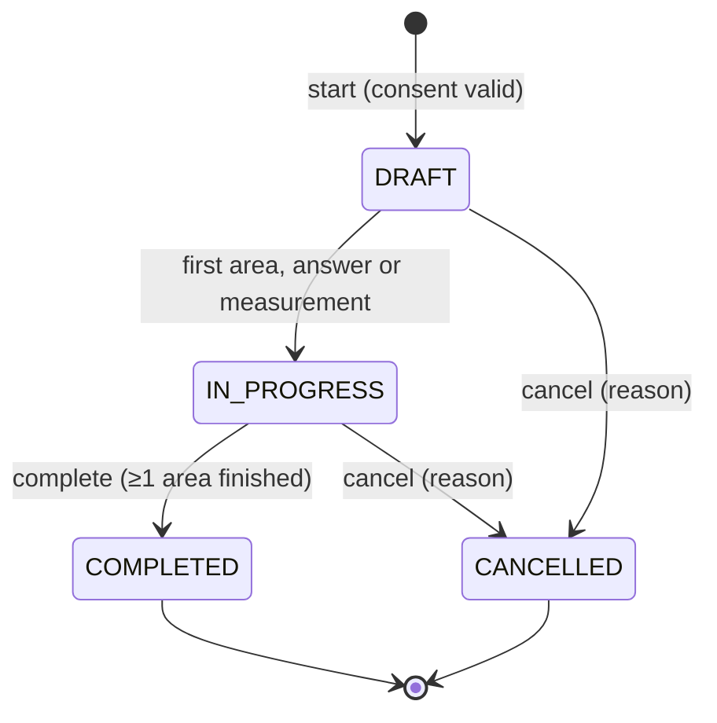

# Four-D Screening Workflow (Step 6)

> Status: implemented end to end (2026-11-22). Question content in development is
> **demonstration content** (not clinically approved); see
> [clinical-content-governance.md](clinical-content-governance.md).

## 1. Worker journey

| # | Worker does | App screen | API | Checks (server) |
|---|---|---|---|---|
| 1 | Signs in, opens the dashboard | Dashboard: "Screened today" (real), "Start screening" | `GET /auth/me`, `GET /screenings/summary` | Token; `screening.conduct` |
| 2 | Start screening | Screening home: own counts, unfinished screenings | `GET /screenings?mine=true&status=…` | `child.read`, area scope |
| 3 | Chooses a child | Choose child (search) | `GET /children` | Area scope |
| 4 | Sees eligibility | Before screening: age (approximate if estimated), consent, areas available, blockers | `GET /children/:id/screening-eligibility` | Scope; consent evaluated; age in days (India date); protocol selection |
| 5 | Records consent if missing | Step 5 consent screen | `POST /children/:id/consents` | Step 5 rules |
| 6 | Starts | Session hub | `POST /screenings` | Consent (assert), scope, age, an available protocol, one open session, idempotent |
| 7 | Chooses one or more Four-D areas | Area card: Start / Continue / View | `POST /screenings/:id/categories` | Protocol covering the age **at session start**; integrity hash for approved content |
| 8 | Answers, one part at a time | Questions | `POST …/categories/:c/responses` | Owner, open, version, consent; answer vs question type and rules; question belongs to the version |
| 9 | Records measurements | Measurements | `POST …/measurements`, `…/corrections` | Units, precision, plausibility, time; corrections supersede |
| 10 | Finishes an area | Questions → Finish | `PATCH …/categories/:c` | Every required question has an explicit state |
| 11 | Saves and leaves, or continues | Home → "Continue a screening" | `GET /screenings/:id` | Answers already saved per section (server draft) |
| 12 | Reviews and completes | Review → confirm | `POST /screenings/:id/complete` | ≥1 finished area; transactional, idempotent |
| 13 | Reads the summary | Summary | `GET /screenings/:id` + protocols | Observations only |
| 14 | Looks at history | Child profile → Screening history | `GET /children/:id/screenings` | `child.read`, scope |
| - | Or cancels | Hub → Cancel (reason) | `POST /screenings/:id/cancel` | Owner, open, version (no consent needed) |

## 2. Session lifecycle

- COMPLETED and CANCELLED are final: the session, its areas, answers and measurements can no
  longer change, and sessions are never deleted (database triggers).
- Completion is idempotent: repeating it returns the original completion time (concurrent
  completions too).
- Every change bumps `version` by one; a write with an old version is refused (409).
- At most one open session per child (partial unique index). Starting again points to it.
- Amendment of completed screenings: **not implemented** (no approved workflow; decision H).

## 3. Area (category) states

| State | Meaning | Shown as |
|---|---|---|
| No row | Never started in this session | "Not started"; after completion: "Not assessed in this screening" |
| IN_PROGRESS | Started, not finished | "In progress"; after completion: "Incomplete" |
| COMPLETED | Every required question has an explicit state | "Questions finished" (info colour, never green) |
| (eligibility) | No protocol for the age / ambiguous content | "Not available" |

A completed session does **not** mean all four Ds were assessed.

## 4. Answer states

| State | Value | Meaning |
|---|---|---|
| (no record) | - | Not answered. Never counted as "No" |
| ANSWERED | Required, type-checked | Yes/No, number, text, option(s) |
| UNKNOWN | None | Asked; the answer is not known |
| NOT_ASSESSED | None (optional reason) | Not checked |
| UNABLE_TO_ASSESS | None (optional reason) | Could not be checked (incl. declined) |

Each answer also records its source (worker observed / guardian reported), optional notes, who
recorded it and when.

## 5. Age and eligibility

- Age in completed days = calendar days from the stored date of birth to today's India date (day
  of birth = 0; leap days counted). The app never sends an age.
- An estimated date of birth is allowed. It is shown as "About …" everywhere, and the session
  stores `dobEstimatedAtStart` so the screening is marked for clinical review.
- The age band is chosen with the age at session start and is never re-computed.
- A date of birth after today: "age not determinable"; no protocol, no screening.

## 6. What the summary says

"Screening observations recorded." "No approved screening rules are set up, so the app gives no
result or recommendation. If you are concerned, follow the approved referral protocol." Plus,
per area, the answers with source and notes; incomplete and not-assessed areas; current
measurements and the number of corrections. The app never says "diagnosed", "definitely has" or
"healthy"; a test enforces this.
