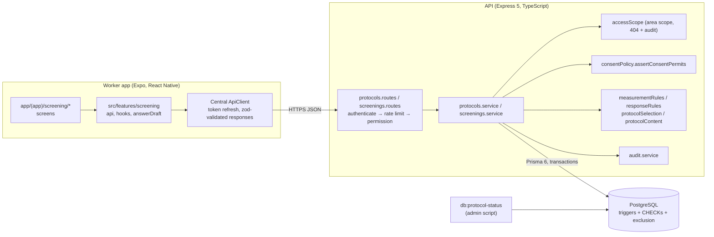

# Screening Architecture (Step 6)

> Status: Step 6 complete (stages 6B-6E, 2026-11-22). Screening **support**, not diagnosis: no
> component produces a diagnosis, classification, score or recommendation.

## 1. Components

| Layer | Responsibility | Files |
|---|---|---|
| Shared contracts | Zod schemas and types for every request and response; date and age helpers | `packages/shared-contracts/src/{screening,dates}.ts` |
| Database | Integrity rules that hold for every account (frozen content, lifecycle, one open session, final sessions, consent-bound sessions, answer and value consistency, insert-only measurements) | `prisma/migrations/20261122120000_step6_screening_foundation` |
| Clinical content | Versioned protocols, content hash, demonstration content, governed lifecycle | `modules/screening/{protocolContent,demoProtocols,protocolLifecycle}.ts`, `prisma/protocol-status.ts` |
| Rules | Age in days (India date), protocol selection, answer validation, measurement data quality | `screeningAge.ts`, `protocolSelection.ts`, `responseRules.ts`, `measurementRules.ts` |
| Services | Eligibility; sessions: start, categories, answers, measurements, complete, cancel, lists, history, summary | `protocols.service.ts`, `screenings.service.ts`, `sessionDto.ts` |
| Routes | Authentication, shared per-user rate limit, route permission, strict validation | `protocols.routes.ts`, `screenings.routes.ts` |
| App | 10 screens, answer drafts in memory, version-conflict recovery, unsaved-changes guard | `apps/worker-app/app/(app)/screening/**`, `src/features/screening/**` |

## 2. Defence in depth for a write

1. **Authentication:** a valid access token (Step 3). Otherwise 401.
2. **Rate limit:** the per-user child-data write limit, shared with children and consent.
3. **Route permission:** `screening.conduct` for writes, `child.read` for reads. Otherwise 403, audited.
4. **Strict request schema:** unknown fields are rejected (mass assignment). Worker, age, area,
   consent, timestamps and status are never accepted from the client.
5. **Area scope:** the session's child must be in the caller's current area. Otherwise 404, the
   same as non-existent, audited.
6. **Row lock:** `SELECT … FOR UPDATE` on the session serialises concurrent writes.
7. **Ownership:** only the conducting worker. Otherwise 403, audited.
8. **Open + version:** `SESSION_FINAL` / `VERSION_CONFLICT` (409).
9. **Consent at the point of use:** a valid SCREENING consent is re-checked in the same
   transaction (cancellation is exempt). Otherwise 403, audited.
10. **Business rules:** protocol selection, answer/value checks, measurement data quality (422).
11. **Database triggers and CHECKs:** the same integrity rules again, for every account. A missed
    case becomes 409 `INTEGRITY_RULE_VIOLATION`, never 500 with database text.
12. **Audit:** written in the same transaction (identifiers and counts only).

## 3. Key decisions (approved A-U, see [initial-audit.md](initial-audit.md))

- Per-category, age-banded, versioned protocols (A). The exact version used is stored per
  category, with its status at the time.
- Clinical wording is stored in the database with the version, plus a SHA-256 (C, D). Frozen once
  reviewed or used.
- Only ACTIVE content in production. Draft and demonstration content only outside production (B, F).
- Online-only screening. No screening data on the device (Q).
- No outcome or recommendation: `screeningRulesApplied` is always `false` (P).

## 4. Data flow of one screening

See [four-d-workflow.md](four-d-workflow.md). Entities and database rules:
[screening-data-model.md](screening-data-model.md). Endpoints: [screening-api.md](screening-api.md).
Security: [security-review.md](security-review.md).
