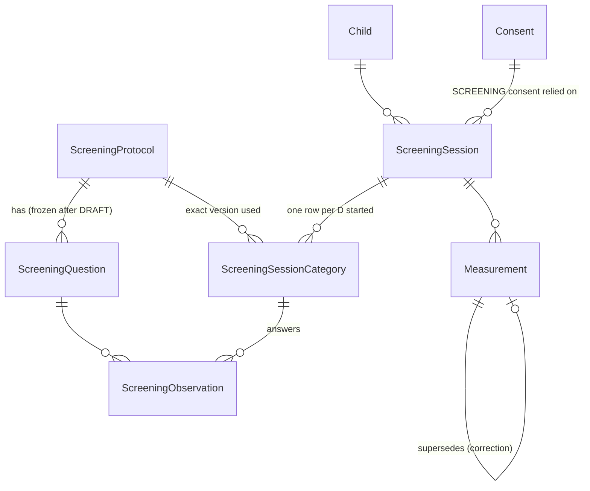

# Screening Data Model (Step 6)

> Status: Stage 6B (2026-11-22). Migration `20261122120000_step6_screening_foundation`, applied
> to the dev and test databases. Approved decisions A-K, N and O in
> [initial-audit.md](initial-audit.md). The source design is [../database-design.md](../database-design.md) (D13).

## 1. Entities

| Entity | Meaning | Key rules |
|---|---|---|
| `ScreeningProtocol` | One version of one Four-D category's questions for one age band | `(code, version)` unique. `status` follows `ProtocolStatus`. `isDemonstration` content can never be approved. `contentSha256` is fixed when the protocol leaves DRAFT |
| `ScreeningQuestion` | A question of a protocol version | `prompt`/`help`/option labels are stored `{hi, en}` (the approved wording). `category` must equal the protocol's. Frozen with the protocol |
| `ScreeningSession` | One screening visit for one child | Server-computed `ageInDaysAtStart`, `dateOfBirthAtStart`, `dobEstimatedAtStart`, `areaId` snapshot, `screeningConsentId`. `version` for optimistic locking. `protocolId` is deprecated (always null) |
| `ScreeningSessionCategory` | One Four-D category screened in the session | `(sessionId, category)` unique. `protocolId` = the exact version; `protocolStatusAtStart` shows whether approved content was used. IN_PROGRESS / COMPLETED; no row = not assessed |
| `ScreeningObservation` | The answer to one question (the "screening response") | `(sessionId, questionId)` unique. `status` ANSWERED / UNKNOWN / NOT_ASSESSED / UNABLE_TO_ASSESS. `source` WORKER_OBSERVED / GUARDIAN_REPORTED. No row = not answered |
| `Measurement` | Weight, height, length, MUAC, ... | Value **as entered** + unit, `source` MEASURED / GUARDIAN_REPORTED / FROM_RECORD, device, quality flag, time, recorder. Insert-only; a correction supersedes |

Unchanged and not used in Step 6: `ScreeningResult` (no approved rules produce outcomes),
`AiAnalysis`, `Referral`, `MediaMetadata`.

## 2. Database-enforced rules

These hold for **every** database account (the owner too), not just the API.

| Rule | Mechanism |
|---|---|
| Only an unused DRAFT protocol can change; content and questions are frozen after review or first use | trigger `screening_protocol_protect`, `screening_question_protect` |
| Lifecycle DRAFT -> IN_REVIEW -> APPROVED -> ACTIVE -> RETIRED (IN_REVIEW -> DRAFT for rework) | trigger |
| APPROVED/ACTIVE/RETIRED need approver, approval time, approval reference and content hash; never demonstration content | CHECK `protocol_approval_complete` |
| Approval record, effective date and retirement are immutable once set | trigger |
| No two ACTIVE protocols of one category overlap in age | EXCLUDE `screening_protocol_one_active_per_band` |
| A session needs a GRANTED, not withdrawn SCREENING consent **of the same child** | trigger `screening_session_protect` |
| One open (DRAFT / IN_PROGRESS) session per child | partial unique index `screening_one_open_session_per_child` |
| Session status: DRAFT -> IN_PROGRESS / CANCELLED; IN_PROGRESS -> COMPLETED / CANCELLED. Completion needs at least one completed category | trigger |
| `version` must increase by exactly 1 on every session update | trigger (raised as `serialization_failure`) |
| COMPLETED / CANCELLED sessions are final: no change to the session, its categories, answers or measurements; sessions and categories are never deleted | triggers |
| Cancellation records who, when and why | CHECK `session_cancellation_complete` |
| A category uses a protocol of the same category that is ACTIVE or DRAFT, covers the session age, and records its true status | trigger `screening_category_protect` |
| A category completes only when every required question has an explicit state | trigger |
| Answers: question must belong to the category's protocol version; the category must belong to the same session and be IN_PROGRESS | trigger `screening_observation_protect` |
| ANSWERED carries a value; UNKNOWN / NOT_ASSESSED / UNABLE_TO_ASSESS carry none; the reason only with NOT_ASSESSED / UNABLE_TO_ASSESS | CHECKs |
| Measurements are insert-only; their child equals the session's child; a correction is the same child, session and type, has a reason, and each row is superseded at most once | trigger `screening_measurement_protect`, CHECK, unique `supersedesId` |
| Values > 0 | CHECK `measurement_value_positive` (Step 2) |

Runtime account (`db:setup-roles`): TRUNCATE revoked on all screening tables (TRUNCATE bypasses
row triggers); DELETE also revoked on `ScreeningSession`, `ScreeningSessionCategory` and
`Measurement`. Verified read-only with `has_table_privilege` on the dev database.

## 3. Age

`ageInDaysAtStart` = calendar days from the stored date of birth to the screening date in India
(Asia/Kolkata), day of birth = 0 (`ageInDaysOn` in `shared-contracts/src/dates.ts`). Leap days are
calendar days; no fixed-length month or year is assumed. A date of birth after the screening date
gives "age not determinable" and no protocol. An estimated date of birth is carried with the
session (`dobEstimatedAtStart`) and shown with the age.

## 4. Migration notes

- Additive. It refuses to run if any screening table already holds rows, because the new
  NOT NULL columns would need a designed backfill.
- `ScreeningProtocol.status` changed type in place (`USING status::text::"ProtocolStatus"`); no
  column was dropped.
- Prisma 6 cannot express the triggers, CHECKs, partial index or exclusion constraint. `prisma
  migrate diff` shows no drift, but **every future generated migration must be reviewed** so it
  never drops them.

## 5. Amendments (stage 6G-1, migration `20261123100000_step6g_screening_amendments`)

| Entity | Meaning | Key rules |
|---|---|---|
| `ScreeningAmendment` | One new version of a COMPLETED screening | `(sessionId, sequence)` unique; basis CONDUCTOR_WITHIN_WINDOW / MEDICAL_OFFICER; reason encrypted; reviewStatus NOT_REQUIRED / PENDING / REVIEWED |
| `ScreeningAmendmentChange` | One changed item: RESPONSE, MEASUREMENT or CATEGORY_NOTES | Exact old and new values (JSON; free text encrypted); clinically significant flag |
| `ScreeningAmendmentReferralImpact` | A referral made from the screening, to be reassessed | Referral status at the time; PENDING → REASSESSED (Step 7) |

Database rules (every account):

- An amendment is accepted only for a COMPLETED session, with `sequence = last + 1`, while
  holding the session row lock. It can never be inserted as REVIEWED.
- No DELETE. The only UPDATE of an amendment is the one-time PENDING → REVIEWED review.
  Changes can never be updated. Referral flags only PENDING → REASSESSED once.
- Changes and referral flags can be added **only in the same transaction** as their amendment.
- Change targets must belong to the same session; a question must belong to the protocol version
  of its area.
- CHECKs: reason present; review status matches significance; review and reassessment fields
  complete.
- Runtime account: no DELETE or TRUNCATE on the three tables.
- The original completed session, its areas, answers and measurements are untouched: the 6B
  completed-session lock is unchanged.
